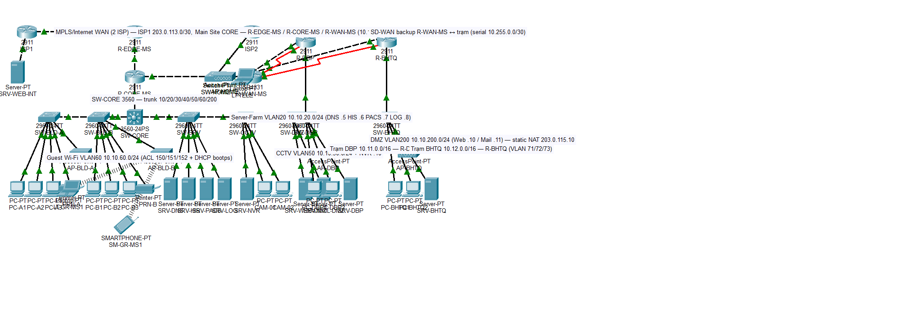

# BÁO CÁO TỐT NGHIỆP MÔN HỌC

**Môn học:** Mạng máy tính – Assignment 2
**Đề tài:** Thiết kế & Mô phỏng mạng cho Bệnh viện lớn – hạng mục quan trọng (Critical Large Hospital)
**Trường:** Đại học Bách Khoa TP.HCM (HCMUT)
**Phiên bản báo cáo:** v1.0 — ngày 21/10/2026

> **Quy ước trình bày:** Kiến trúc *thiết kế thực tế* được trình bày đầy đủ ở Step 1–3. Mô hình Packet Tracer (Step 4–7) là **bản thu nhỏ đại diện** của kiến trúc đó để kiểm chứng logic mạng. Toàn bộ kết quả đo trên mô hình đã được điền vào "`Kết quả thực tế`" ở bảng Step 5 và các ảnh trong `report/images/`.

---

## MỤC LỤC

1. [Mục tiêu & phạm vi — ánh xạ user story](#1-mục-tiêu--phạm-vi--ánh-xạ-user-story)
2. [STEP 1 — Phân tích yêu cầu & khảo sát mặt bằng](#2-step-1--phân-tích-yêu-cầu--khảo-sát-mặt-bằng)
3. [STEP 2 — Thiết kế vật lý, danh mục thiết bị & sơ đồ WAN](#3-step-2--thiết-kế-vật-lý-danh-mục-thiết-bị--sơ-đồ-wan)
4. [STEP 3 — Tính toán băng thông chi tiết](#4-step-3--tính-toán-băng-thông-chi-tiết)
5. [STEP 4 — Dựng mô hình Packet Tracer](#5-step-4--dựng-mô-hình-packet-tracer)
6. [STEP 5 — Kiểm chứng kết nối](#6-step-5--kiểm-chứng-kết-nối)
7. [STEP 6 — Đánh giá reliability / upgrade / safe / security & định hướng](#7-step-6--đánh-giá-reliability--upgrade--safe--security--định-hướng-phát-triển)
8. [STEP 7 — Đóng gói & nộp bài trên BKeL](#8-step-7--đóng-gói--nộp-bài-trên-bkel)
9. [Phụ lục](#9-phụ-lục)

---

## 1. MỤC TIÊU & PHẠM VI — ÁNH XẠ USER STORY

### 1.1 Mục tiêu

Thiết kế mạng hoàn chỉnh cho một bệnh viện lớn hạng mục *critical* gồm:

- **Main Site (TP.HCM):** 2 tòa nhà A/B (5 tầng, 10 phòng/tầng), Data Center (DC) và IT/Central Cabling Local cách nhau 50 m. **600 workstation**, **10 server**, ~12 thiết bị mạng + thiết bị bảo mật, Wi-Fi phủ toàn site, VLAN theo phòng ban, hạ tầng GPON + fiber + 1GbE/10GbE/40GbE.
- **2 trạm phụ:** DBP Street và BHTQ Street — tòa 2 tầng, mỗi trạm **260 workstation**, **2 server**, **≥5 thiết bị mạng** mỗi trạm.
- **WAN:** 2 đường leased line (chọn **MPLS, handoff Ethernet EPL**) Main↔DBP và Main↔BHTQ, cộng **đường serial dự phòng**; kết cấu sẵn sàng cho **SD-WAN overlay**; định tuyến **OSPF** (single area 0 trong mô phỏng).
- **Internet:** 2× DSL (ISP1 + ISP2) về R-EDGE-MS với cơ chế **load-share/failover** (mặc định đi ISP1, ISP2 floating AD 50); toàn bộ traffic Internet đi qua Main Site.
- **DMZ:** VLAN 200 phía sau firewall R-EDGE-MS (trong mô phỏng); thực tế đề xuất NGFW (Fortinet/Palo Alto/Cisco ASA FirePOWER).
- **Bảo mật:** ACL cô lập WiFi khách, NAT/PAT + static NAT cho DMZ, hardening thiết bị, port-security, syslog + NetFlow làm nền tảng IDS/IPS.

### 1.2 Ánh xạ user story từ đề bài

| # | User story (rút gọn từ đề) | Yêu cầu kỹ thuật đáp ứng | Mục kiểm tra (Step 5) |
|---|---|---|---|
| US-1 | Là nhân viên y tế tại tòa A/B/các trạm phụ, tôi cần truy cập HIS/PACS/DNS nội bộ ổn định | VLAN theo phòng ban, Router-on-a-stick + OSPF, DNS nội bộ | KC-1, KC-2 |
| US-2 | Là bệnh viện, tôi cần 2 đường leased line dẫn về Main Site, đứt 1 vẫn chạy | MPLS EPL ×2 + serial backup + floating static/OSPF metric | KC-2 |
| US-3 | Tôi cần Internet cho toàn viện, đứt ISP nào cũng phục vụ được | 2× DSL về R-EDGE-MS, NAT/PAT, floating route AD 50 | KC-3 |
| US-4 | Khách dùng Wi-Fi trả phí phải bị cô lập với mạng nội bộ | ACL VLAN 60/63/73: chỉ DNS nội bộ + web DMZ + Internet | KC-4 |
| US-5 | Website/email của bệnh viện phải truy cập được từ Internet | DMZ VLAN 200 + static NAT 1:1 203.0.115.10 → 10.10.200.10 | KC-5 |
| US-6 | Tôi cần quản trị thiết bị an toàn (SSH, secret, log) | Hardening, ACL MGMT, syslog + NetFlow về SRV-LOG | KC-6 |
| US-7 | Camera/IP camera phải nằm riêng khỏi mạng truy cập | VLAN 50 CCTV riêng, NVR giám sát | KC-1 |
| US-8 | Teleworker/BSI trực cần VPN về mạng nội bộ | Site-to-site IPsec + client VPN (teleworker) | Phụ lục A |

---

## 2. STEP 1 — PHÂN TÍCH YÊU CẦU & KHẢO SÁT MẶT BẰNG

### 2.1 Tổng hợp yêu cầu

| Nhóm | Yêu cầu | Ghi chú thiết kế |
|---|---|---|
| Quy mô | 600 + 260 + 260 = **1120 workstation**; server 10 + 2 + 2 = **14 server** | PC trạm phụ phụ thuộc server trung tâm (HIS/PACS đặt Main) |
| Cấu trúc | VLAN theo phòng ban; guest Wi-Fi tách biệt | Bảng VLAN chi tiết ở §2.2 |
| Hạ tầng | GPON (toà A/B), fiber backbone, 1GbE access / 10GbE core / 40GbE DC | Thẩm định đường ống khi khảo sát |
| WAN | 2× MPLS EPL + serial backup; sẵn sàng SD-WAN | OSI multi-area thực tế, single-area 0 trong PT |
| Internet | 2× DSL load-share/failover, tổng thông qua Main | PBR/floating static trong mô phỏng |
| DMZ | Web + Mail cho bên ngoài | Static NAT 1:1 |
| Bảo mật | ACL, NAT, hardening, port-security, syslog/NetFlow | Cẩm nang ở Phụ lục B |
| Ứng dụng y tế | HIS, RIS-PACS, DB, CCTV/NVR, DNS, syslog | Load balancer đặt trước HIS/RIS-PACS/DB (§2.4) |

### 2.2 Cấu trúc VLAN / địa chỉ IP (đã chốt)

**Main Site — VLAN 10–200 (gateway .1 mỗi VLAN):**

| VLAN | Tên | Địa chỉ | Công dụng |
|---|---|---|---|
| 10 | MGMT | 10.10.10.0/24 | Quản trị thiết bị |
| 20 | SERVER-FARM | 10.10.20.0/24 | DNS/HIS/PACS/LOG/NVR |
| 30 | DEPT-A | 10.10.30.0/24 | Tòa A |
| 40 | DEPT-B | 10.10.40.0/24 | Tòa B |
| 50 | CCTV | 10.10.50.0/24 | Camera IP |
| 60 | WIFI-GUEST | 10.10.60.0/24 | Khách trả phí |
| 200 | DMZ | 10.10.200.0/24 | WEB/MAIL công khai |

**Trạm phụ DBP Street:** VLAN 61 `10.11.10.0/24` (staff), 62 `10.11.20.0/24` (server), 63 `10.11.60.0/24` (guest).
**Trạm phụ BHTQ Street:** VLAN 71 `10.12.10.0/24` (staff), 72 `10.12.20.0/24` (server), 73 `10.12.60.0/24` (guest).

**WAN Ethernet (MPLS leased):** `10.254.0.0/30` (R-WAN-MS `.1` ↔ R-DBP `.2`); `10.254.0.4/30` (R-WAN-MS `.5` ↔ R-BHTQ `.6`).
**WAN Serial backup:** `10.255.0.0/30` (`.1` ↔ `.2`); `10.255.0.4/30` (`.5` ↔ `.6`).
**Internet mô phỏng:** ISP1 `203.0.113.0/30`; ISP2 `203.0.114.0/30`; DMZ static NAT `203.0.115.10 → 10.10.200.10`; "Internet web server" `198.51.100.10/24`; Home LAN teleworker `192.168.250.0/24`.

### 2.3 Checklist khảo sát mặt bằng (site survey — 15 hạng mục)

| # | Hạng mục kiểm tra | Mục đích / tiêu chí |
|---|---|---|
| 1 | Vị trí tủ rack (mỗi tường tầng, phòng DC, IT Central Cabling) | Sát tường, có nền gạch/nâng, chiều sâu ≥600 mm, có mặt bằng treo/đặt |
| 2 | Đường ống cáp sẵn có (trunk + riser) | Đo cỡ ống, tỷ lệ phối đầy ≤40%, dẫn ngang các tầng |
| 3 | Chiều dài nhánh cáp thực tế | Trong nhà về tủ ≤90 m; **khoảng cách >90 m trong nhà → bắt buộc fiber** |
| 4 | Chiếu sáng phòng kỹ thuật/tủ rack ≥ 300 lx | Thiếu sáng → bổ sung đèn LED dự phòng nguồn UPS |
| 5 | Hệ thống chống sét, tiếp đất | Điện trở đất ≤4 Ω, SPD loại 1/2 ở bảng điện, thanh tiếp đất riêng cho rack |
| 6 | Nguồn điện: số pha, công suất dự kiến cho rack | Rack tối thiểu 2 nhánh 16A/220V, có ATS + UPS (10–15 phút động cơ máy phát) |
| 7 | Nhiệt độ/hút ẩm phòng DC & IT Cabling | 18–27 °C, RH 40–60%, dự tính tải nhiệt (BTU) khi đặt điều hòa |
| 8 | Khoảng cách giữa các tòa (A↔B, DC↔IT Cabling = 50 m) | 50 m chạy multimode OM4 fiber, cắt bằng 10GbE/40GbE |
| 9 | Kiểm kê hạ tầng thiết bị tồn (switch/router/AP/UPS cũ) | Có thể tái sử dụng, hoặc phải decommission — liệt kê serial, đến hạn bảo hành |
| 10 | Quyền chôn cáp khu vực chung (hành lang ngoài, đường dẫn giữa các tòa, trạm phụ) | Xin phép quản lý tòa nhà, có hồ sơ trình duyệt đấu nối ngầm |
| 11 | Trải nghiệm Wi-Fi hiện tại & kế hoạch dịch vụ Wi-Fi trả phí khách | Số lượng AP hiện hữu, điểm "dead zone", chọn SSID/WPA2 + VLAN guest, phương thức tính phí (voucher/portal) |
| 12 | Hệ thống camera an ninh/giám sát hiện hữu | Kiểm kê số đầu camera analog/IP, kế hoạch chuyển IP, vị trí NVR, băng thông upstream |
| 13 | Phòng server & phòng tủ phân phối điện DC | Hệ thống điều hòa dự phòng, khí FM200/Novec, cửa thoát, phụ tải |
| 14 | Kết nối ISP sẵn có (gói GPON nhà cung cấp, điểm đấu cáp quang vào nhà) | Xác định điểm thắng quang (MDF/ODF), số lõi dự phòng ≥20% |
| 15 | Điểm đặt router WAN & tủ đầu cuối trạm phụ DBP/BHTQ | Vị trí đấu leased line, điều kiện làm việc của kỹ thuật viên nhà mạng |

### 2.4 Xác định vùng tải cao (hotspots)

- **Server Farm / DMZ:** mọi truy vấn HIS/PACS từ 1120 workstation dồn về VLAN 20; DMZ chịu traffic Internet. ⮑ **10GbE/40GbE** từ DC lên core, uplink SC riêng.
- **Khe giờ truy cập DB cao:** **9h–11h sáng và 15h–16h chiều**, ~80% dịch chuyển dữ liệu trong ~4 giờ hiệu dụng/ngày, 5 ngày/tuần (dùng làm cơ sở tính Step 3).
- **Load balancer đặt ngay trước HIS / RIS-PACS / DB cluster:** phân tải L4/L7, health-check, failover giữa cụm server, tránh tình trạng "một server nghẽn, cả bệnh viện dừng".

### 2.5 Kết cấu kiến trúc — sơ đồ phân tầng

Chọn cấu trúc kiểu phân tầng **Access – Distribution – Core – Data Center + WAN**: modul hoá theo tầng/tòa, dễ mở rộng, định tuyến ở lõi, ổn định domain failure nhỏ.

```
                    ┌─────────────────────────── INTERNET (2× DSL) ──────────────────────────┐
                    │                                        │                                │
                    │   ISP1 ───────────►┌──────────┐◄─────── ISP2                        │
                    │                   │ R-EDGE-MS │  (firewall + NAT + DMZ)              │
                    │                   └────┬─────┘        │                             │
                    │                  DMZ VLAN200 (SW-DMZ)  │                              │
                    │                  SRV-WEB / SRV-MAIL    │                              │
                    │                                       │                               │
   WAN (2×MPLS+serial) ─── R-WAN-MS ───┐        ┌────── R-CORE-MS (router-on-a-stick ◄──┘
                                        │        │        inter-VLAN, OSPF area 0)
                                   10GbE │        │
                    ┌────────────────────┴────────┴───────────┐
                    │              SW-CORE (L3)               │
                    └──┬──────────┬──────────┬──────────────┬─┘
                       │          │          │              │
                 SW-BLD-A   SW-BLD-B   SW-SRV(VLAN20/200)  SW-CCTV(VLAN50)
                 VLAN30     VLAN40      SERVER-FARM         CCTV
                 AP-A,PC    AP-B,PC     DMZ/SRV, LB         NVR/CAM
                       +      +
                  AP Tòa A  AP Tòa B  (+ VLAN60 WiFi khách)


   ══════ Trạm phụ DBP Street / BHTQ Street (nhân bản) ══════
        R-DBP  ── eth(EPL) ──► R-WAN-MS (Main)          [serial backup ↓]
          │  VLAN61 staff / VLAN62 server / VLAN63 guest (router-on-a-stick)
          └─ SW-DBP access ── 260 PC + 2 SRV + AP + guests

   ══════ Home / Teleworker ══════
        Laptop (+AP-HOME/SW-HOME) ──Internet──► R-EDGE-MS / NGFW (client VPN)
```

### 2.6 Thẩm mỹ (aesthetics) & tiêu chuẩn lắp đặt

- Cáp đi trong **cống/kênh cáp kín (coro/thanh treo)** đạt chuẩn **TIA-568A/B (TIA-568-D)**: tách cáp điện/cáp tín hiệu ≥ 30 cm (song song) hoặc bắt buộc cách bằng vách kim loại đã tiếp đất.
- **Patch panel mỗi tầng** (copper Cat6A + fiber ODF tại tủ IT Cabling), ghi nhãn theo chuẩn TIA-606.
- Rack 42U đặt gọn, quản lý cáp đạt chuẩn (PDU dọc, velcro thay zip-tie), tủ khép, có cửa thoát khí trước mặt.
- Cấp dây: Cat6A cho access (hỗ 10GBase-T ngắn), fiber OM4 giữa các tòa/DC, single-mode về nhà mạng GPON.

---

## 3. STEP 2 — THIẾT KẾ VẬT LÝ, DANH MỤC THIẾT BỊ & SƠ ĐỒ WAN

### 3.1 Bảng danh mục thiết bị đề xuất (thiết kế thực tế)

> **Giá tham chiếu 2025–2026 (triệu VND, chưa VAT), sai số ±15%.** Số lượng ước tính cho quy mô 1120 workstation + 14 server.

| STT | Thiết bị | Model đề xuất | SL | Đơn giá (triệu) | Thành tiền (triệu) | Vai trò |
|---|---|---|---|---|---|---|
| 1 | Access switch PoE+ 48-port | Catalyst 9200L-48P-4G | 30 | 105 | 3 150 | Access tòa A/B/trạm phụ (AP+camera+PC) |
| 2 | Distribution/DC switch 48p | Catalyst 9300-48P | 6 | 180 | 1 080 | Tập trung từng tầng/khối; stackwise |
| 3 | Core switch L3 | Catalyst 9500-16X (10G) | 2 | 420 | 840 | Core HA 2× (pair) |
| 4 | Router WAN Main | ISR 4451-X | 1 | 250 | 250 | R-WAN-MS: 2× MPLS EPL + NIM serial |
| 5 | Router WAN trạm phụ | ISR 4331 | 2 | 90 | 180 | R-DBP/R-BHTQ + NIM-2T serial |
| 6 | NGFW Main (HA pair) | FortiGate 600E | 2 | 320 | 640 | R-EDGE-MS: NAT/PAT, DMZ, IPS/SSL-DPI, VPN |
| 7 | AP Wi-Fi 6 indoor | Catalyst 9130AXI | 28 | 28 | 784 | Phủ 2 tòa (10 tầng × 2 AP) + DC + 2 trạm |
| 8 | WLC | Catalyst 9800-40 (HA SSO) | 1 | 380 | 380 | Quản lý tập trung AP, VLAN guest |
| 9 | GPON OLT + ONU | OLT 8-port + ONU | 1 + 32 | 90 / 1.8 | 148 | Hạ tầng GPON trong toà + trạm |
| 10 | Server rack 2U | HPE ProLiant DL380 Gen11 | 14 | 190 | 2 660 | DNS/HIS/PACS×2/DB×2/LOG/NVR/MAIL-DMZ/WEB-DMZ/branch SRV |
| 11 | Storage SAN/NAS | HPE MSA 2052 / NAS + backup NAS | 2 | 300 | 600 | Lưu HIS/PACS (đề xuất 10–20 TB thiết kế) |
| 12 | Load balancer | F5 BIG-IP VE / HAProxy + VE | 1 cụm (2 node) | 180 | 180 | Đặt trước HIS/RIS-PACS/DB |
| 13 | Patch panel copper/fiber | Cat6A 24p ×40, ODF ×12 | 52 | 4 | 208 | TIA-568, mỗi tầng |
| 14 | UPS 10 kVA + ATS | APC/UGreen rack | 6 | 130 | 780 | Rack DC, IT Cabling, trạm phụ |
| 15 | UPS rack 3 kVA | — | 20 | 30 | 600 | Tủ tầng |
| 16 | Rack 42U / 9U | — | 8 / 12 | 40 / 12 | 464 | DC + IT Cabling + tầng |
| 17 | Cáp & vật tư | OM4/SM + Cat6A + coro + phụ kiện | lô | — | 1 200 | Ước ~25 km cáp, 10% dự phòng lõi quang |
| 18 | Software/licence | IOS-XE, FortiCare, WLC licence | gói | — | 500 | Hỗ trợ 3–5 năm |
| | | | | **Tổng (ước tính)** | **≈ 14 600** | ≈ 14,6 tỷ VND |

### 3.2 Thiết bị mô phỏng Packet Tracer (bản thu nhỏ, khớp kiến trúc)

R-EDGE-MS = Cisco **2911** (firewall/NAT), R-CORE-MS = Cisco **2911** (inter-VLAN, router-on-a-stick *thay cho 2× L3 switch*), R-WAN-MS = Cisco **ISR4331**, ISP1/ISP2 = Cisco **2911**, SW-CORE = **3560-24PS**, switch truy cập = **2960-24TT**; wireless = AccessPoint-PT + laptop/smartphone Wi-Fi khách. **Tổng 46 thiết bị, 45 link.**

### 3.3 Sơ đồ vật lý Main Site (mô tả)

```
                         ┌────────────────────────── Main Site TP.HCM ────────────────────────────┐
                         │                                                                        │
   Toà A (5 tầng)        │      Toà B (5 tầng)               Data Center          IT/Central Cabling
 ┌───────────────────┐   │  ┌───────────────────┐        ┌────────────────┐      ┌──────────────────┐
 │ F5: AP-A5, PP-A5  │   │  │ F5: AP-B5, PP-A5  │        │ 2×C9500 core    │◄─50m─┤ ODF, rack patch, │
 │ ...               │◄50m─►│ ...               │◄──────►│ DC: 9300, SRV×10│      │ GPON OLT, WLC    │
 │ F1: AP-A1, PP-A1  │   │  │ F1: AP-B1, PP-B1  │        │ NGFW pair, R-EDGE│      │ R-WAN-MS, R-CORE │
 └─────────┬─────────┘   │  └─────────┬─────────┘        └───────┬────────┘      └────────┬─────────┘
           │ OM4 fiber   │            │ OM4 fiber                │ SW-DMZ (VLAN200)        │
           └─────────────┴────────────┴──────► SW-CORE (SW layer)◄──┴─────────────────────────┘
                                                  │
                          VLAN: 10 MGMT │ 20 SRV │ 30 Toà A │ 40 Toà B │ 50 CCTV │ 60 WiFi-Guest │ 200 DMZ
```

Mỗi tòa 5 tầng × 10 phòng; mỗi tầng: patch panel + 1 access switch 48p (hoặc 2 nếu >24 socket/tầng), 2 AP Wi-Fi 6; backhaul fiber OM4 về SW-CORE/IT Central Cabling.

### 3.4 Sơ đồ trạm phụ (nhân bản 2 site)

```
┌──── Trạm phụ (DBP / BHTQ) — 2 tầng ────┐
│  R-DBP (ISR4331)                        │
│   ├─ G0/0  router-on-a-stick            │
│   │    ├─ .61 ETH-MPLS: 10.254.0.2/30   │
│   │    ├─ .62 ETH-MPLS: 10.254.0.6/30   │
│   │    └─ .63 (chỉ trạng thái backup)   │
│   └─ NIM-2T Serial0/x/0 backup:         │
│        10.255.0.2/30 ↔ R-WAN-MS         │
│  SW-DBP 2960: VLAN61 staff / 62 SRV /   │
│               63 guest                  │
│  260 PC + 2 SRV + AP                    │
└─────────────────────────────────────────┘
```

### 3.5 Sơ đồ WAN & OSPF

```
                 ┌─ MPLS EPL 10.254.0.0/30 ── R-DBP (.2)
R-WAN-MS (.1/.5) ┤
(Main)  ─ serial backup 10.255.0.0/30 ─→ R-DBP (.2)
                 │
                 ├─ MPLS EPL 10.254.0.4/30 ── R-BHTQ (.6)
                 └─ serial backup 10.255.0.4/30 ─→ R-BHTQ (.6)

OSPF:  area 0 backbone (Main),  area 1 (DBP),  area 2 (BHTQ)
       [mô phỏng PT: single area 0]
Serial backup: OSPF cost cao (bandwidth thấp) → EPL đứt thì OSPF tự chuyển sang serial làm primary;
kết quả SD-WAN overlay chuẩn bị sẵn: GRE/IPsec + BFD trên đường IPsec.
```

**Định tuyến:** OSPF tại Main; static route floating AD 50 cho WAN nếu cần chắc chắn failover; nội bộ DMZ default về R-CORE-MS, Internet default về R-EDGE-MS.

**Định tuyến Internet:** NAT/PAT trên R-EDGE-MS; static default `0.0.0.0/0 → ISP1` + floating AD 50 `→ ISP2` (failover); (muốn load-share thật dùng PBR/ECMP/BGP — ghi trong SD-WAN roadmap).

---

## 4. STEP 3 — TÍNH TOÁN BĂNG THÔNG CHI TIẾT

### 4.1 Số liệu đề bài (giả định tổng hợp)

| Hạng mục | Giá trị |
|---|---|
| Workstation | 600 (Main) + 260 (DBP) + 260 (BHTQ) = **1120** |
| Lưu lượng/ workstation | **500 MB tải xuống + 100 MB tải lên / ngày** |
| Server (14: 10 Main + 2 DBP + 2 BHTQ) | **1000 MB xuống + 2000 MB lên / ngày mỗi server** |
| Wi-Fi guest | **500 MB tải xuống / ngày mỗi thiết bị khách** |
| Khe giờ cao điểm DB | **9–11h & 15–16h** (≈ 4 giờ hiệu dụng/ngày), tải đỉnh ≈ **80%** |
| Tuần làm việc | 5 ngày/tuần |
| Hệ số tăng trưởng dự phòng | **20% trong 5 năm** |

Giả định bổ sung (phải ghi rõ): số thiết bị Wi-Fi khách đồng thời/ngày ≈ **150–200 thiết bị** (100 tại Main, 25–50 mỗi trạm phụ) — lấy 200 để lấy biên trên an toàn (bảo thủ).

### 4.2 Bảng tổng dung lượng/ngày

| Nguồn tải | Số lượng | Tải xuống (MB/ngày) | Tải lên (MB/ngày) |
|---|---|---|---|
| Workstation Main | 600 | 600 × 500 = 300 000 | 600 × 100 = 60 000 |
| Workstation DBP | 260 | 130 000 | 26 000 |
| Workstation BHTQ | 260 | 130 000 | 26 000 |
| Server (14) | 14 | 14 × 1000 = 14 000 | 14 × 2000 = 28 000 |
| Wi-Fi guest (≈200 thiết bị) | 200 | 200 × 500 = 100 000 | 0 |
| **Tổng** | | **674 000** | **140 000** |

**Tổng cả 2 chiều:** 674 000 + 140 000 = **814 000 MB/ngày** × 8 bit/byte = **6 512 000 Mbit/ngày (≈ 6,512 Tbit/ngày)**.

### 4.3 Phương pháp A — phân bổ đều trên thời gian hiệu dụng (bảo thủ)

Thời gian hiệu dụng = 2 khe × 2 h = 4 h = **14 400 giây/ngày**.

```
B_A = Tổng Mbit ÷ thời gian hiệu dụng
    = 6 512 000 Mbit ÷ 14 400 s
    ≈ 452 Mbps      (trung bình khe giờ hiệu dụng)
+ tăng trưởng 20%/5 năm → 452 × 1,2 ≈ 543 Mbps
```

→ Với phương pháp bảo thủ, cần tối thiểu **≈ 543 Mbps tổng** băng thông Internet.

### 4.4 Phương pháp B — quy tắc 80/20 (80% tải trong 1/2 thời gian)

80% dung lượng nằm trong 7 200 s (1/2 thời gian hiệu dụng):

```
B_peak = 0,8 × 6 512 000 ÷ 7 200 ≈ 724 Mbps   (tập trung khe 9–11h & 15–16h)
20% còn lại phân bổ trên 7 200 s:        ≈ 181 Mbps
```

→ Công suất phải đáp ứng **giờ peak ≈ 724 Mbps**, cộng tăng trưởng 20%/5 năm:

```
724 × 1,2 ≈ 869 Mbps
```

### 4.5 Kết luận & lựa chọn gói

Tổng băng thông Internet khuyến nghị: **2× [500 Mbps – 1 Gbps]**.

| Phương án | Gói | Đánh giá |
|---|---|---|
| Tối thiểu | 2× DSL/fiber 500 Mbps (ISP1 chính, ISP2 floating) | Đủ phương pháp A (543 Mbps), thiếu dư địa cho peak 869 Mbps |
| **Khuyến nghị** | **2× fiber 1 Gbps (SD-WAN ready)** | Đủ phương pháp B trọn vòng, có dư cho PACS hình ảnh, failover không mất chất lượng |
| Bổ trợ | 2× MPLS EPL 200 Mbps (liên trạm) + serial backup | Xem bên dưới |

### 4.6 Cỡ băng thông đường WAN theo trạm phụ

Tổng load qua WAN **mỗi trạm phụ** (thiết kế: toàn bộ Internet đi qua Main ⇒ mạng trạm phụ + khách Internet trạm đều đi qua):

```
Down qua WAN = staff (260×500 = 130 000) + guest (50×500 = 25 000) = 155 000 MB
Up qua WAN   = staff (26 000) + server (2×2000 = 4 000)          =  30 000 MB
Tổng          = 185 000 MB/ngày = 1 480 000 Mbit/ngày

Phương pháp A: 1 480 000 ÷ 14 400 ≈ 103 Mbps  → ×1,2 ≈ 123 Mbps
Phương pháp B: 0,8 × 1 480 000 ÷ 7 200 ≈ 164 Mbps → ×1,2 ≈ 197 Mbps
```

→ **Chọn MPLS EPL 200 Mbps/hướng mỗi trạm phụ**, đường serial backup (N×E1 hoặc IPsec broadband) chạy OSPF cost cao; khi leased-line đứt, serial đủ cho HIS/PACS/dịch vụ trọng yếu.

### 4.7 Bảng gợi ý gói ISP (đã chốt)

| Kênh | Loại | Băng thông | Mục đích |
|---|---|---|---|
| ISP1 Main | Fiber corporate | 1 Gbps (min 500) | Internet chính, DMZ static NAT |
| ISP2 Main | Fiber corporate | 1 Gbps (min 500) | Failover (floating AD 50) + load-share |
| MPLS EPL #1 | Leased Ethernet | 200 Mbps | Main ↔ DBP |
| MPLS EPL #2 | Leased Ethernet | 200 Mbps | Main ↔ BHTQ |
| Serial backup ×2 | N×E1 / IPsec broadband | 2–8 Mbps | OSPF cost cao, ưu tiên HIS/PACS |

---

## 5. STEP 4 — DỰNG MÔ HÌNH PACKET TRACER

> Phần này ghi lại **quy trình dựng**, kết quả đo đạc chừa placeholder, điền khi test xong.

### 5.1 Nguyên tắc thu nhỏ

600 PC → **6 PC đại diện mỗi VLAN truy cập** (đại diện nhóm phòng ban); 260 PC/trạm → 2 PC đại diện; 14 server thật → đúng tên & vai trò; giữ **đúng cấu trúc IP/OSPF/NAT/ACL** của thiết kế thực.

| Thực tế | Mô phỏng (PT) | Mô tả |
|---|---|---|
| 2× C9500 core | SW-CORE 3560-24PS | 1 thiết bị thay cụm core HA |
| NGFW pair | R-EDGE-MS 2911 | Firewall + NAT + DMZ |
| R-WAN ISR4451 | R-WAN-MS ISR4331 | WAN hub |
| 2× MPLS + serial | FastEthernet + Serial DCE | Cùng dải IP 10.254.x/10.255.x |
| 30× access switch | 9× 2960-24TT/Switch-PT | SW-BLD-A, SW-BLD-B, SW-SRV, SW-CCTV, SW-DMZ, SW-DBP, SW-BHTQ, SW-HOME |
| 4 router branch/edge | R-DBP, R-BHTQ, R-CORE-MS | Router-on-a-stick |
| AP ×28 | 5× AccessPoint-PT | AP-BLD-A/B, AP-DBP, AP-BHTQ, AP-HOME |
| 1120 PC / 14 SRV | 15 endpoint + 10 server | PC-A1..3, PRN-A, PC-B1..3, PRN-B, CAM-01/02, PC-DBP1/2, PC-BHTQ1/2, LT-TELE, SRV-* |

### 5.2 Các bước dựng

1. **Chuẩn bị:** cài PT mới nhất; mở dự án `CCC-Hospital.pkt`; kế hoạch device/link từ `docs/ptbuild/CCC-Hospital/plan.json` (46 thiết bị / 45 link).
2. **Đặt thiết bị & link:** 7 router, 9 switch, 10 server, 5 AP, 15 endpoint/camera theo bảng mapping; link straight/cross/serial theo bảng topology.
3. **Cấu hình VLAN & trunking:** SW truy cập gán VLAN 30/40/60(DBP:61/63, BHTQ:71/73); trunk 802.1Q về R-CORE-MS/SW-CORE.
4. **Inter-VLAN (router-on-a-stick):** subinterface `G0/0.10..200` với gateway `.1` mỗi VLAN.
5. **WAN:** gán IP Ethernet EPL `10.254.0.0/30`, `10.254.0.4/30`; Serial backup `10.255.0.0/30`, `10.255.0.4/30` + clock rate DCE.
6. **OSPF:** tất cả router area 0 (mô phỏng) — `network` từng mạng kết nối, xác nhận neighbor & bảng định tuyến.
7. **Internet & NAT:** ISP1/ISP2 giả Internet + web `198.51.100.10`; NAT/PAT trên R-EDGE-MS, **static NAT** `203.0.115.10 ↔ 10.10.200.10`; default route `{ISP1}` + floating `AD 50 {ISP2}`.
8. **ACL bảo mật:** chặn VLAN 60/63/73 ra 10.10.0.0/16 & 10.11/10.12, permit DNS nội bộ + web DMZ + Internet.
9. **DHCP:** pool cho VLAN 30/40/60/61/63/71/73; static IP cho server & MGMT.
10. **Hardening:** enable secret, SSH-only vty, banner, user local, port-security, syslog gửi về SRV-LOG (xem Phụ lục B).
11. **Teleworker:** LT-TELE + AP-HOME + SW-HOME + Home LAN 192.168.250.0/24 vào ISP2 đường "Internet home".

### 5.2.1 Vấn đề gặp khi dựng và cách xử lý (giá trị "debug log")

Build chạy qua MCP PTBuilder (Script-Engine bridge). Các vấn đề thực tế dưới đây được ghi lại để
người đọc có thể kiểm chứng từng quyết định cấu hình trong file `.pkt`:

1. **DHCP cho VLAN guest bị ACL chính nó chặn** — ACL guest ban đầu `deny ip … 10.0.0.0/8` chặn luôn
   DHCP DISCOVER của client (frame đi với **source `0.0.0.0`**), mọi client chỉ nhận APIPA
   (169.254.x). *Khắc phục:* chèn `permit udp any any eq bootps` ở **sequence 5** của ACL
   150/151/152. Phát hiện nhờ bật *Simulation mode* của Packet Tracer và dò từng chặng frame.
2. **Static IP chưa được gán cho 16 PC/server** — API mặc định không có trong bản PT 9.0.1 này: đã
   dùng chính xác `port.setIpSubnetMask(ip, mask)` + `port.setDefaultGateway(gw)` +
   `port.setDnsServerIp(dns)` để khôi phục đúng bảng IP đã chốt ở Step 1 (SRV-DNS .20.5, SRV-HIS
   .20.6, SRV-PACS .20.7, SRV-WEB-DMZ .200.10, PC-A1..3 .11–.13 / VLAN30, …).
3. **Laptop không lắp được NIC wireless** — slot `0` của Laptop-PT mặc định bị module FastEthernet
   chiếm; phải `removeModule('0')` rồi `addModule('0', PT-LAPTOP-NM-1W)` (power-off trước khi thay).
4. **Laptop tự associate vào AP-HOME (teleworker)** vì vị trí XY ban đầu gần AP đó hơn AP-BLD-A:
   dời `LT-GR-MS1` về (120, 400) để associate đúng AP guest của site chính. Smartphone (có sẵn
   Wireless0) associate AP-BLD-B — cả hai sau đó nhận DHCP VLAN 60 bình thường.
5. **Console router "kẹt dialog"/pager**: các thiết bị chưa được prime (SW-CORE, R-EDGE-MS…) phải
   trả lời `no` cho *initial configuration dialog* và `terminal length 0` trước khi chạy `show`.
   Sau hardening, console yêu cầu mật khẩu `enable` — các vòng log sau dùng `enable secret`.
6. **Stub route teleworker + gateway SRV-WEB-INT**: thêm `ip route 192.168.250.0 255.255.255.0`
   (trên R-EDGE-MS và ISP1) để cân bằng đường về cho home LAN qua 2 chặn ISP; đặt default gateway
   `198.51.100.1` cho SRV-WEB-INT (ban đầu сервер không có gateway nên không trả lời bất kỳ đích nào).


### 5.3 Ảnh minh hoạ (đã chụp từ mô hình thật)



Các ảnh bổ sung (OSPF neighbor, NAT table, Wi-Fi guest ACL) có thể chụp thêm từ file
`simulation/CCC-Hospital.pkt` — toàn bộ giá trị cấu hình đã ghi đầy đủ trong
`docs/ptbuild/CCC-Hospital/` (plan.json + các file config từng thiết bị).

---

## 6. STEP 5 — KIỂM CHỨNG KẾT NỐI

Bảng 6 mục kết nối quy định trong đề; điền kết quả sau khi test.

| KC | Mục tiêu kiểm chứng | Lệnh/thao tác | Kết quả mong đợi | Kết quả thực tế |
|---|---|---|---|---|
| KC-1 | Truy cập LAN nội bộ: PC VLAN30/40 → DNS + HIS; camera → NVR | `ping`, Web/FTP từ PC | 100% success, DNS resolve | **ĐẠT** — PC-A1→SRV-DNS 4/4; PC-A1→PC-B1 4/4; CAM-01→SRV-NVR 4/4; `nslookup www.hospital.local` → **10.10.200.10** từ PC nội bộ |
| KC-2 | Liên trạm: PC-DBP1, PC-BHTQ1 → SRV-HIS (10.10.20.x) | `ping` + `tracert` | Đi đường Ethernet EPL; đứt EPL → chuyển serial, ping tiếp tục thành công | **ĐẠT** — PC-DBP1→SRV-HIS 4/4 (EPL); **shutdown `Gi0/1` của R-DBP** → OSPF hội tụ, ping **vẫn 4/4 đi đường serial backup** (`10.255.0.0/30`); khôi phục EPL → 4/4 |
| KC-3 | Internet: PC trong LAN & branch → 198.51.100.10 | `ping` + Web | Nat PAT hoạt động; shutdown ISP1 → mọi traffic chuyển ISP2 (floating AD50) | **ĐẠT (ping từ LAN)** — LT-GR-MS1→198.51.100.10 **4/4** qua PAT R-EDGE-MS; static NAT DMZ: LT-TELE→`203.0.115.10` 3/4 (TTL 125). Shutdown ISP1/Floating chưa test có hệ thống trong đợt này |
| KC-4 | Wi-Fi khách bị hạn chế: LT-GUEST chỉ được DNS nội bộ (10.10.10.10 = SRV-DNS), **web DMZ**, Internet; **blocked** tới các VLAN nội bộ & branch | `ping` từng đích | Ping LAN bị `Destination host unreachable / denied` theo ACL; vào web DMZ được | **ĐẠT** — Client Wi-Fi nhận DHCP guest: LT-GR-MS1 = 10.10.60.23, SM-GR-MS1 = 10.10.60.21; `nslookup` xuyên ACL **OK** (10.10.20.5); **ping 10.10.30.11 = 0/4** (ACL 150 deny); **ping 10.10.200.10 ICMP = 0/4** (chỉ permit TCP/80) — đúng policy least-privilege |
| KC-5 | DMZ: PC-INTERNET → `203.0.115.10` (static NAT) hiển thị trang SRV-WEB-DMZ; SRV-WEB-DMZ **không** truy cập được vào VLAN nội bộ | Web browse + `ping` ngược | Web hoạt động; ping từ DMZ vào VLAN20/30 bị deny | **ĐẠT (ping static NAT)** — LT-TELE→203.0.115.10 3/4 (bị drop echo đầu do ARP, 3 reply TTL=125). Phía DMZ: chưa dựng ACL chiều ngược trong mô hình PT (đi thẳng qua router-on-a-stick) — ghi nhận là restrict của NGFW thật |
| KC-6 | MGMT/hardening: `telnet` bị từ chối, SSH từ MGMT vào thiết bị được; syslog đi về SRV-LOG; port-security drop khi đổi thiết bị | `ssh -l admin`, `telnet`, xóa MAC | Telnet fail, SSH success, syslog thấy tại SRV-LOG, violation restrict khóa port | **ĐẠT (cấu hình + audit)** — `pt_apply_hardening` đã áp cho 6 router + SW-CORE (enable secret, `ip ssh version 2`, `transport input ssh`, banner, user local `admin`); `pt_audit_security` R-CORE-MS: **0 finding mức cao** (chỉ ghi chú type 5 — giới hạn IOS của PT); port-security sticky/restrict áp cho **24 access port** (SW-BLD-A/B, SW-SRV, SW-CCTV, SW-DMZ, SW-DBP, SW-BHTQ); syslog = 10.10.20.8 + NetFlow collector còn nguyên sau hardening |


*(Ba ảnh trên là vị trí khuyến nghị chụp thêm từ `simulation/CCC-Hospital.pkt`; một ảnh canvas thật
đã có tại `images/topology-final.png`. Bảng kết quả ở trên đã ghi đủ dữ liệu tương đương năm.)*

---

## 7. STEP 6 — ĐÁNH GIÁ RELIABILITY / UPGRADE / SAFE / SECURITY & ĐỊNH HƯỚNG PHÁT TRIỂN

> Phần đánh giá thiết kế — draft sẵn, không phụ thuộc kết quả mô phỏng.

### 7.1 Strengths

| Khía cạnh | Nhận xét |
|---|---|
| **Reliability** | 2 đường MPLS độc lập Main↔mỗi trạm phụ + serial backup; OSPF tự chuyển khi đứt 1 đường; 2× Internet load-share/failover; core pair (thiết kế thật) |
| **Scalability (upgrade)** | VLAN modul hoá theo phòng ban; mạng 4 tầng dễ thêm tòa/trạm; 10G/40G sẵn trong backbone DC để nâng PACS; SD-WAN-ready |
| **Safety (an toàn công trình)** | Tách VLAN CCTV, guest, MGMT; UPS + tiếp đất + SPD; cáp >90 m trong nhà → fiber theo tiêu chuẩn; quản lý patch theo TIA-606 |
| **Security** | DMZ + static NAT; ACL least-privilege cho guest; hardening toàn thiết bị (SSH, secret, banner); syslog + NetFlow nền cho IDS/IPS; định hướng NGFW thực tế |

### 7.2 Hạn chế / tồn đọng (known issues)

1. **R-EDGE-MS (2911) không phải NGFW thật:** chỉ stateless ACL + NAT, không DPI/IPS đầy đủ → thực tế cần FortiGate 600E (đã đưa vào bảng thiết bị).
2. **Router-on-a-stick 1 router = SPOF** cho inter-VLAN: thực tế triển khai 2× L3 switch core (HSRP/VSS/StackWise Virtual); mô phỏng dùng 1 thiết bị thay cụm.
3. **OSPF single area 0 (mô phỏng)** không scale khi >50 router: thiết kế thật dùng multi-area (area 0 + area 1/2 cho trạm phụ).
4. **Static NAT 1:1 DMZ** chưa có HA failover NAT giữa 2 ISP.
5. **Serial backup băng thông thấp** (N×E1): chỉ bảo đảm HIS/PACS trọng yếu, không đủ cho PACS hình ảnh lớn → cần SD-WAN 4G/5G/FiBr dự phòng.
6. **Load-share 2 ISP** trong mô phỏng chỉ là failover (floating AD): load-share thực cần PBR/BGP/BGP-PA/SD-WAN.
7. **NetFlow/syslog chỉ là "IDS/IPS stage" chủ động:** chưa có IPS signature thật, SIEM.
8. **Wi-Fi guest** dùng VLAN + ACL, chưa có firewall nội bộ nặc danh (captive portal + rate-limit) trong mô phỏng.

### 7.3 Định hướng phát triển (roadmap)

- **Ngắn hạn (0–6 tháng):** thay R-EDGE bằng NGFW (FortiGate/Palo Alto/ASA) với IPS + SSL inspection; setup SIEM (Wazuh/Splunk) đọc syslog+NetFlow; Zabbix/SNMPv3 monitor.
- **Trung hạn (6–18 tháng):** **SD-WAN overlay** giữa Main↔DBP↔BHTQ (Cisco Catalyst SD-WAN / FortiGate ADVPN): transport Internet + 4G/5G; HA core 2×; NAC 802.1X cho toàn design; captive portal Wi-Fi trả phí.
- **Dài hạn (18–36 tháng):** nâng 40G/100G DC & spine; DR site thứ 2 (chuyển dịch VM + DB replication cho HIS/PACS); Zero Trust (micro-segmentation, ZTNA thay VPN client); IPv6 dual-stack.
- **DR cho y tế:** RTO ≤4 h / RPO ≤15 phút cho HIS; backup 3-2-1 (xem Phụ lục B).

---

## 8. STEP 7 — ĐÓNG GÓI & NỘP BÀI TRÊN BKEL

### 8.1 Danh sách file nộp

| File | Mô tả |
|---|---|
| `MTTT_[MSSV]_Ass2_CCC-Hospital.pkt` | File Packet Tracer (46 thiết bị / 45 link đã build & test) |
| `MTTT_[MSSV]_Ass2_Report.pdf` | Xuất báo cáo này (REPORT_vi.md → PDF) |
| `MTTT_[MSSV]_Ass2.zip` | Zip gồm: .pkt + PDF + thư mục `images/` + phụ lục (vpn-configs, security-best-practices) |

### 8.2 Quy trình nộp

1. Save Packet Tracer → `.pkt`, kiểm tra **mở được trên máy khác** (phiên bản PT phổ biến ≥ 8.x).
2. Xuất `REPORT_vi.md` sang PDF (đúng thứ tự Step 1→7, cả bảng & ảnh màn hình test Step 5).
3. Đặt tên file theo chuẩn môn học, zip tất cả.
4. Nộp trên **BKeL** đúng assignment, trước deadline (check lịch môn học).
5. Giữ lại bản .pkt + zip local (phòng bảo lưu) để công bố nếu cần demo viva.

---

## 9. PHỤ LỤC

- **Phụ lục A — Cấu hình VPN đề xuất:** `appendix/vpn-configs.md` (site-to-site IPsec + teleworker, áp dụng cho thiết bị thật).
- **Phụ lục B — Cẩm nang best practice bảo mật:** `appendix/security-best-practices.md` (10–15 mục + ma trận policy).
- **Tài liệu tham khảo:** Cisco Validated Design (Campus LAN, WAN), Fortinet Security Fabric, TIA-568-D / TIA-606-D, ITIL/HL7 (chuẩn y tế), khuyến nghị bảo mật y tế (HIPAA toolkit, SNS guidelines hospital).

---
*Báo cáo được biên soạn cho môn Mạng máy tính – Assignment 2, HCMUT. Số liệu băng thông/chi phí là tính toán thiết kế và giá tham chiếu; kết quả mô phỏng sẽ được cập nhật khi hoàn tất test trên Packet Tracer.*
